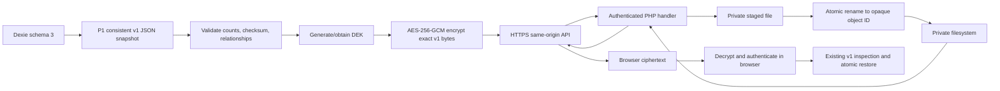

# ALPHA-01 / P3 — Server Backup Architecture and Security Design

**Status:** Architecture and investigation only. No source, schema, backup format, Service Worker, hosting configuration, endpoint, or production file was changed.

**Protected contracts:** Dexie schema 3, Backup Format v1, existing financial calculations and allocation behavior, append-only audit history, Asia/Tehran business date, and production origin `https://hesab.54i.ir`.

**Evidence labels:**

- **VERIFIED** — observed directly in the repository, or stated in the supplied hosting qualification record for this phase.
- **INFERRED** — consequence of verified implementation or hosting facts.
- **PROPOSED** — design recommendation for a later implementation phase.
- **UNKNOWN** — requires a future controlled test or owner decision.

## 1. Executive summary

**VERIFIED.** TasviehYar is a single-user, browser-first PWA. Dexie/IndexedDB is the working database, and the local backup service serializes eight stores into plaintext JSON Backup Format v1. P1 added a consistent readonly export transaction, atomic replace-all restore, explicit restore history status, and Service Worker v5 API bypass rules. The current P1 changes are present in the working tree but have not been deployed.

**VERIFIED — supplied qualification evidence.** The hosting account is cPanel on CloudLinux 9 with LiteSpeed. Web PHP is 8.1.34 using the `litespeed` SAPI. OpenSSL, JSON, Fileinfo, and ZIP are available. PHP reached `/home/jtphyqur/.private`, created and removed a temporary file outside the production document root `/home/jtphyqur/hesab.54i.ir`, and the qualification files were removed. No new subdomain is required for the proposed design.

**PROPOSED.** Add an opt-in, same-origin PHP service that receives only a browser-encrypted opaque container. The browser validates the existing v1 JSON, encrypts its exact bytes using AES-256-GCM, and sends ciphertext over HTTPS. PHP stores the ciphertext outside the document root with generated object IDs and minimal metadata. PHP never parses, decompresses, decrypts, logs, or indexes financial content.

The recovery design must survive browser-data deletion, reinstallation, and device replacement. The recommended approach is envelope encryption with a random 256-bit data-encryption key (DEK), a user-held recovery secret, and an optional passphrase-derived wrapping key. The server stores the ciphertext and a wrapped DEK, but neither the server account credential nor the storage host can recover the DEK alone. The recovery secret must be exported and stored independently before the first remote upload.

This report does not claim production readiness. Authentication, staging routing, quota behavior, concurrent upload behavior, filesystem isolation, and real browser cache behavior still require controlled implementation tests.

## 2. Verified current architecture

### Application and local data

**VERIFIED — source.** `TasviehYarDatabase` declares Dexie schema version 3 with these eight stores: `parties`, `destinationAccounts`, `invoices`, `paymentInstructions`, `payments`, `paymentAllocations`, `paymentVerifications`, and `auditEvents`. Financial values are nonnegative safe integer toman values. Derived balances are not separate editable records.

**VERIFIED — source.** `BackupService` exports all eight stores, record counts, application identifier, Backup Format version 1, schema version 3, creation timestamp, and a SHA-256 checksum over the reconstructed unsigned envelope. Zod validates the envelope and domain relationships. P1 performs the eight-store read in one Dexie readonly transaction.

**VERIFIED — source and tests.** Restore validates before writing, then clears and bulk-writes all eight stores in one Dexie read/write transaction. A transaction failure rejects before a committed replacement. History in browser storage is ancillary: after commit, the service returns `historyStatus: "recorded"` or `"failed"`; the UI distinguishes these outcomes.

**VERIFIED — source.** Local backup history is a capped list of the latest 20 entries in `localStorage`. It is not part of the eight-store financial snapshot and is not a server backup manifest. Local JSON backups remain plaintext and contain sensitive names, banking identifiers, payments, notes, and audit descriptions.

### Service Worker v5

**VERIFIED — source and P1 tests.** `public/sw.js` uses `tasviehyar-shell-v5`. It keeps shell/static caching and offline navigation behavior, but bypasses all requests under `/api/` and `/backup.php` before cache lookup or insertion, including non-GET requests. It also rejects cache insertion for `no-store`, redirected, or private final responses. Runtime API responses are not substituted from the offline shell cache. P1 tests exercise those branches in a VM with mocked Cache Storage.

**UNKNOWN.** The P1 worker has not been deployed or exercised in a real browser on a separately isolated origin. LiteSpeed, browser HTTP cache, CDN behavior, redirects, SPA rewrites, and the effective active Service Worker must be tested together before remote backup use.

### Current authentication

**VERIFIED — source.** The repository contains no remote authentication provider, PHP authentication endpoint, session implementation, or server backup client. The current application is intentionally single-user and local-first.

**INFERRED.** “Single user” reduces account complexity but does not remove authentication. A stolen session cookie or publicly reachable object ID would expose encrypted payload availability and metadata, and an attacker who controls the same-origin frontend could capture a recovery passphrase or key during use.

## 3. Proposed architecture

### Components

1. **Existing React client:** remains the only component that understands Backup Format v1 and financial records. It creates a consistent local snapshot with the P1 service.
2. **Browser crypto module:** validates the v1 JSON, constructs an encrypted wrapper, derives or imports key material, and decrypts downloaded wrappers. Plaintext is never sent to PHP.
3. **Same-origin PHP API:** a small PHP 8.1-compatible handler behind LiteSpeed. It authenticates the single operator, validates request framing and metadata, and performs bounded file operations only.
4. **Private filesystem:** `/home/jtphyqur/.private/tasviehyar-backups/` or an equivalent owner-controlled directory outside `/home/jtphyqur/hesab.54i.ir`. PHP writes temporary files and committed objects under this private root. The exact subdirectory, ownership, mode, quota, and `open_basedir` behavior require staging confirmation.
5. **No database and no permanent Node service:** object metadata can be stored in bounded sidecar metadata or reconstructed from filenames and authenticated headers. A MariaDB migration is outside the approved architecture.

### Data flow



**PROPOSED.** Upload must publish only after the complete ciphertext has been received, framed, authenticated for its header, size-checked, and durably renamed. Download returns opaque bytes as an attachment. Decryption, v1 parsing, compatibility checks, and restore remain browser operations.

## 4. Encryption and key-management design

### Encrypted container

**PROPOSED.** Define a separate transport wrapper, for example `tasviehyar-server-backup-enc` version 1. This does not change the inner Backup Format v1 JSON. Use a deterministic bounded header encoded as canonical bytes and authenticated as AES-GCM additional authenticated data (AAD):

| Field | Purpose | Secret? |
| --- | --- | --- |
| `containerVersion` | Reject unknown wrapper versions | No |
| `algorithmProfile` | Fix AES-GCM, tag length, KDF/wrapping profile | No |
| `keyId` | Select the local recovery key/wrapped DEK | No |
| `createdAt` | Display and recovery ordering | No; do not treat as freshness proof |
| `innerFormat` / `innerSchema` | Expect Backup Format 1 / schema 3 | No |
| `salt` and KDF parameters | Derive a wrapping key if passphrase recovery is enabled | No |
| `nonce` | Fresh AES-GCM IV, 96 bits | No |
| `wrappedDek` | DEK encrypted under the recovery wrapping key | Yes in the confidentiality sense |
| `ciphertext` and GCM tag | Exact v1 JSON bytes plus authentication tag | Yes |

Use a length-delimited binary frame or a canonical JSON header followed by raw bytes. Do not hash a pretty-printed or reserialized object after encryption. Bound every length before allocation. Reject unknown versions, duplicate fields, invalid nonce/tag lengths, oversized ciphertext, malformed framing, and unexpected trailing bytes.

**PROPOSED crypto profile:** AES-256-GCM with a fresh cryptographically random 96-bit nonce for every encryption and a 128-bit authentication tag. Use `crypto.getRandomValues` and Web Crypto `subtle.encrypt/decrypt`. Never reuse a nonce with a DEK. Authenticate the header as AAD so a server-side replacement of the key ID, format, timestamp, or ciphertext fails decryption.

### Recommended recovery model

**PROPOSED.** Generate a random 256-bit DEK per remote snapshot or per key epoch. Generate a random 256-bit recovery secret once per user/key epoch. Wrap the DEK under a key derived from that recovery secret. Store the wrapped DEK and public `keyId` in the container; store the recovery secret only outside the server and browser database.

For usability, the recovery secret may be exported in two forms:

- a machine-readable encrypted key file or QR/text representation for careful offline storage; and
- a human-readable grouped recovery code with a checksum, intended for a password manager or physically protected recovery sheet.

The grouped code is an encoding of high-entropy random bytes, not a short memorable password. The app must display it once, require an explicit “I saved this” checkpoint, and offer a test decrypt in a clean browser profile before enabling remote-only recovery.

**Optional second factor — PROPOSED, ALPHA decision required.** To make routine recovery easier, derive a wrapping key in the browser from a user passphrase using PBKDF2-HMAC-SHA-256 with a unique random salt and a calibrated high iteration count, then wrap the DEK. Keep the random recovery secret as the emergency path. The passphrase is never sent to PHP. PBKDF2 is a password-hardening compromise, not equivalent to a hardware-backed or memory-hard KDF; if a suitable browser-supported memory-hard library is later approved, version it as a new profile. Do not use the PHP authentication password as the encryption passphrase.

### Key separation and compromise limits

**PROPOSED.** Separate these credentials:

1. PHP account password/session credential: proves permission to call the API.
2. Recovery secret: unwraps encrypted backup content.
3. Optional encryption passphrase: derives the local wrapping key.

The server stores only a password verifier for the API credential and opaque encrypted objects. It never receives the recovery secret, passphrase, DEK, plaintext v1 JSON, or a decrypt request that includes plaintext. A compromised server can delete, withhold, reorder, or replace opaque objects; it cannot decrypt a correctly implemented container without the recovery material. A compromised same-origin frontend can capture a key while the user enters or uses it, so CSP, dependency review, deployment access control, and same-origin integrity remain necessary.

### Recovery scenarios

| Scenario | Recovery path | Remaining requirement |
| --- | --- | --- |
| Browser data deleted | Reinstall/open the app, authenticate to PHP, import the independently stored recovery secret or passphrase, download a selected container, decrypt, inspect v1, and restore. | The user must have retained the recovery material and an API credential. |
| Browser reinstalled | Same as above; no key is required to remain in IndexedDB. | Run a clean-profile recovery drill before production use. |
| Device replaced | Install the same-origin app, authenticate, import the recovery material from the password manager/offline copy, and recover. | Keep at least one local plaintext v1 backup in a separate protected location as a fallback. |
| Recovery secret lost | Encrypted server copies are unrecoverable by design. | Preserve an independent local v1 backup; do not add a server escrow key without ALPHA approval. |
| API password lost | Reset through the explicitly approved account-recovery procedure. | Do not reset or rotate encryption keys as a side effect of account-password recovery. |
| Same-origin frontend compromised | Attacker may capture live IndexedDB, session, passphrase, or recovery key. | Encryption does not defend an active compromised client; revoke the API session, rotate credentials/keys, and recover from an independently verified local copy. |

### Replay and replacement

**PROPOSED.** AES-GCM provides authenticity of the selected container, not freshness. A server can replay an older valid ciphertext. List metadata should expose opaque ID, server receipt time, client creation time, size, digest, and key ID. The client should show the selected snapshot’s date/counts only after decryption and should warn when a downloaded snapshot is older than the locally recorded last-known snapshot. An authenticated monotonic client backup sequence can improve detection, but it is not a server-trusted counter and must not block recovery. Before every replacement restore, create and retain a fresh local checkpoint. Never silently overwrite a server object; upload creates a new immutable object ID.

## 5. Minimal PHP API contract

**PROPOSED.** Use one same-origin route such as `/api/backup-v1.json` with an internal PHP rewrite. The route must be excluded from SPA fallback, LiteSpeed caching, reverse proxy caching, and Service Worker handling. Query action names are explicit and allowlisted.

| Operation | Method | Request | Response and rules |
| --- | --- | --- | --- |
| Status | `GET` | `action=status` | `200` with API version, capability flags, and server time only. No filesystem path or PHP diagnostics. `Cache-Control: no-store`. |
| List | `GET` | `action=list`, bounded page cursor | `200` with opaque ID, receipt time, client time, size, key ID, wrapper version, and digest. No filename supplied by the client, plaintext, or path. `no-store`. |
| Upload | `POST` | `action=upload`; one opaque binary body; operation ID header/body | `201` only after complete validation and atomic publication. Client retry with the same operation ID is idempotent; never overwrite a different existing object. `413` for size, `429` for rate, `503` for capacity. |
| Download | `GET` | `action=download&id=<strict opaque ID>` | Stream `application/octet-stream` as attachment. Resolve the ID beneath the fixed private root; reject traversal, separators, NULs, symlinks, and unknown IDs. `no-store`, `nosniff`. |
| Delete | `POST` | `action=delete&id=<strict opaque ID>` plus CSRF token | Prefer mark-retired/private-trash rather than immediate unlink. Require fresh authorization and explicit UI confirmation. Do not enable permanent purge in this phase. |

All responses, including errors, must set `Cache-Control: no-store`, avoid redirects, avoid CORS, and return bounded JSON errors for metadata endpoints. The browser must set `fetch(..., { cache: "no-store", credentials: "same-origin" })` and must not include plaintext in query parameters, logs, filenames, or referrers.

### Request validation

**PROPOSED.** Enforce method/action allowlists, maximum body size before reading into memory where the host permits, a strict wrapper magic/version, bounded frame lengths, expected content type, upload error status, one authenticated object per request, and a server-generated object ID. Do not trust `Content-Length`; enforce a streaming byte counter. Reject multipart filenames and user paths. Verify the uploaded ciphertext digest before publication. PHP should not parse the inner v1 JSON.

### Atomic storage operation

**PROPOSED.** Write to a random stage file in the same private filesystem, stream and count the body, close it, apply owner-only mode, fsync if the host/runtime supports a safe implementation, acquire a short lock for metadata/index coordination, and rename atomically to an unguessable final object ID. Publish metadata only after the final rename. On failure, close and remove the stage file and return a retryable error without altering existing objects. A crash-recovery sweep should remove abandoned stage files after a conservative age; automatic retention deletion is outside this phase.

## 6. Authentication, authorization, and threat model

### Authentication

**PROPOSED.** Use a single operator account with a PHP session. Store only a slow password verifier using PHP’s password API; never store a plaintext password or use the encryption key as the login password. Rotate the session ID on login and logout. Cookie attributes: `Secure`, `HttpOnly`, `SameSite=Strict`, narrow API `Path`, and a bounded lifetime. Require HTTPS and reject HTTP operation rather than relying only on a redirect.

For every request, enforce session authentication, account ownership of the object, method/action allowlists, request size limits, and rate limits. Login and state-changing requests need CSRF protection: validate same-origin `Origin`/`Referer` where reliable and require a per-session CSRF token for upload, retirement, and deletion. Same-origin alone is not a complete CSRF defense. Do not enable wildcard CORS.

### Threat model

| Threat | Control | Residual risk |
| --- | --- | --- |
| Stolen server disk or provider backup | Browser AES-GCM; key material kept separately | Metadata, sizes, timing, and availability remain exposed. |
| Public directory/object guessing | Private root, random IDs, authenticated download, no aliases | Misconfiguration or leaked session could still expose ciphertext. |
| Path traversal/symlink abuse | Fixed root, strict ID grammar, realpath/ancestor check, no user filenames | Requires host-specific symlink and `open_basedir` testing. |
| Malicious/oversized upload | Auth, rate/size bounds, streaming counter, stage cleanup | Proxy or account limits may reject before PHP; report clearly. |
| CSRF upload/delete | SameSite cookie, Origin check, CSRF token, no CORS | Browser/platform edge cases require integration tests. |
| Replay of old valid backup | Client metadata warning, immutable objects, local checkpoint | Server cannot prove freshness without a trusted external ledger. |
| Truncated/corrupted ciphertext | Length framing, GCM tag verification, digest, no restore before decryption | User may still select an older valid backup. |
| PHP/LiteSpeed outage | Local-first operation and downloadable local v1 backup | Remote backup unavailable until service recovers. |
| Same-origin XSS or compromised release | CSP/dependency review, protected deployment, separate recovery key | Active client compromise can capture plaintext/key material. |
| Operator credential compromise | Rate limits, session controls, credential rotation | Attacker can delete/withhold ciphertext and metadata. |

## 7. Storage layout and permissions

**VERIFIED — supplied qualification evidence.** `/home/jtphyqur/.private` is outside production document root `/home/jtphyqur/hesab.54i.ir`; PHP Web reached it and created/deleted a temporary file. OpenSSL, JSON, Fileinfo, and ZIP were available. The qualification diagnostic files were removed.

**PROPOSED layout:**

```text
/home/jtphyqur/.private/
  tasviehyar-backups/
    objects/       # opaque encrypted containers only
    stage/         # short-lived upload files
    retired/       # optional recoverable retirement area
    metadata/      # bounded nonfinancial metadata only, if needed
    sessions/      # private session storage if PHP file sessions are used
    config/        # password verifier and nonsecret server settings
```

Do not put any of these paths beneath a document root, public alias, symlinked public directory, or static download location. Use the PHP account identity only, owner-only permissions where supported, a fixed configured absolute root, and explicit `open_basedir`/realpath checks. Disable directory indexes and PHP execution in any reachable staging path as defense in depth. Never rely on an unguessable URL as authorization.

**UNKNOWN.** Effective file modes, directory ownership, `open_basedir`, LiteSpeed external aliases, symlink behavior, PHP session storage, quota, backup-provider retention, and whether the supplied temporary test used the same production PHP pool need staging evidence.

## 8. Service Worker compatibility

**VERIFIED — P1 source.** Every `/api/` path and `/backup.php` path is rejected by `isCacheableRequest` before cache lookup. Therefore list, upload, download, delete, status, POST, and navigation requests in that namespace do not receive Cache Storage lookup, cache-first fallback, or cache insertion. `cacheResponse` additionally rejects `no-store`, redirects, and private final URLs.

**PROPOSED route constraint.** Use only `/api/backup-v1.json` and keep every future backup operation under `/api/`. Do not add a hostname, alternate path, extensionless alias, or redirecting login route without updating the worker tests and deployment routing. PHP/LiteSpeed must exclude the API from SPA fallback and edge caching. Every API response should still send `Cache-Control: no-store`; this is defense in depth, not the primary worker control.

**UNKNOWN.** v5 has not been deployed to the production origin or a staging origin. Before server implementation, test a real browser with an old v4 cache, activate v5, inspect Cache Storage, sign out, go offline, and attempt list/download. Confirm that private responses never appear in Cache Storage, browser HTTP cache, LiteSpeed cache, or SPA fallback responses. Confirm static shell and warmed hashed assets retain offline behavior.

## 9. Recovery and disaster recovery

**PROPOSED operating procedure:**

1. Before enabling remote backup, export a local v1 JSON file and verify it by inspection and re-open in a clean browser profile.
2. Generate/import the recovery secret, display it once, store it independently, and perform a clean-profile decrypt test.
3. Create a browser-encrypted remote container. Record only its opaque ID, client/server timestamps, size, key ID, and digest.
4. For routine recovery, authenticate, list metadata, download ciphertext, verify framing/digest, import the recovery material, decrypt/authenticate, inspect v1, export a fresh local checkpoint, and confirm before atomic restore.
5. For a lost device or browser data, use the same procedure on the same production origin after reinstall. Origin preservation is required for local data, but remote recovery depends on the independent key and authentication credential.
6. For a server outage, continue local work and local export/import. Do not send plaintext or silently queue unbounded remote uploads. Retry with the same idempotency operation ID when the outcome of an upload is unknown.
7. For suspected key compromise, stop remote use, preserve a local copy, revoke the API session, generate a new key epoch, and explicitly re-encrypt selected snapshots. Do not delete old ciphertext until recovery is verified.

**UNKNOWN.** Provider-level disaster recovery, snapshot retention, account restoration, and whether `/home/jtphyqur/.private` is included in host backups were not supplied. Treat server storage as an availability convenience, not the only recovery copy.

## 10. Testing strategy

### Browser/domain tests

**PROPOSED:** preserve all existing v1 fixtures and add deterministic tests for: exact v1 bytes before encryption; AES-GCM successful round trip; changed header/AAD; changed nonce; changed ciphertext/tag; truncated frame; unknown wrapper version; wrong key; wrong key ID; oversized lengths; duplicate header fields; and trailing bytes. Verify decryption fails before any restore write. Test recovery after clearing IndexedDB and in a clean profile.

### PHP unit/integration tests

**PROPOSED:** test framing and byte limits, object ID grammar, traversal and symlink rejection, request authentication, CSRF, rate limiting, upload error codes, stage cleanup, atomic rename, duplicate idempotency ID, download headers, metadata bounds, retired-object behavior, and no plaintext in logs. Use synthetic encrypted fixtures only.

### Staging tests

**PROPOSED:** on an isolated path/account, verify PHP Web SAPI 8.1.34, extensions, effective limits, private-root access, public denial through every alias, HTTPS, LiteSpeed caching, SPA fallback exclusion, interrupted uploads, disk/quota failure, concurrent uploads, session expiry, logout, and unauthorized object IDs. Use only generated ciphertext and remove or retire all test objects after evidence is captured.

### Service Worker tests

**PROPOSED:** real Chrome and Safari profiles with v4 cache seeded, v5 activated, authorized/unauthorized API calls, offline calls, redirect responses, `no-store`, static asset cache, and navigation fallback. Inspect Cache Storage and network traces. No production data or credentials in test profiles.

## 11. Hosting constraints

**VERIFIED — supplied qualification evidence:** LiteSpeed and PHP 8.1.34 are compatible with a small PHP handler, sessions, OpenSSL, JSON, Fileinfo, ZIP, random bytes, and atomic same-filesystem file operations in principle. No new Node process or MariaDB is required.

**INFERRED:** cPanel/CloudLinux changes the earlier DirectAdmin assumption. All instructions, document-root checks, PHP selector settings, LiteSpeed cache bypass, and filesystem paths must follow the actual cPanel account. Do not copy DirectAdmin-specific configuration or `.htaccess` advice without verifying LiteSpeed behavior.

**UNKNOWN:** effective web `upload_max_filesize`, `post_max_size`, `memory_limit`, `max_execution_time`, request timeout, session save path, `open_basedir`, account disk quota, inode quota, LiteSpeed cache rules, ModSecurity/WAF behavior, and whether `.htaccess` overrides are enabled. These must be captured from the web SAPI or host operator before implementation.

## 12. Risks and mitigations

- **Recovery secret loss:** encrypted remote copies become unrecoverable. Mitigation: mandatory independent export and clean-profile drill; retain local v1 copies.
- **Passphrase weakness:** PBKDF2 slows guessing but cannot create entropy. Mitigation: random recovery secret remains primary; calibrate iterations and keep the server login credential separate.
- **Same-origin compromise:** frontend can capture live keys/plaintext. Mitigation: deployment integrity, CSP, dependency review, session revocation, and local recovery copy.
- **Replay:** valid older snapshots can be returned. Mitigation: immutable object IDs, visible metadata, local last-known warning, and pre-restore checkpoint.
- **Private-path misconfiguration:** ciphertext could become publicly downloadable. Mitigation: outside-document-root storage, authenticated handler, direct denial tests, fixed ID resolution, and no aliases.
- **Resource exhaustion:** large uploads consume PHP temp/private space. Mitigation: proxy/PHP/body limits, streaming counters, rate limits, stage cleanup, and clear `413`/capacity failures.
- **Host outage or provider loss:** remote copy unavailable. Mitigation: local-first operation and independently stored local v1 backup.
- **Format drift:** wrapper changes could strand old copies. Mitigation: versioned profiles, fixtures, key epochs, and a compatibility matrix; keep inner v1 unchanged.
- **P1 worker not deployed:** API may be cached by an old worker. Mitigation: deploy v5 only after a real-browser cache test; keep all API paths under `/api/`.

## 13. Implementation phases

1. **P3 approval and staging gate:** approve the wrapper profile, recovery UX, authentication model, route, retention stance, and test-only staging procedure. Capture effective cPanel/LiteSpeed/PHP settings without creating production objects.
2. **P4 browser crypto prototype:** implement the wrapper in isolation with fixtures, recovery export/import, wrong-key/tamper tests, and no PHP dependency. Do not alter v1 or Dexie schema.
3. **P5 PHP staging API:** implement status/list/upload/download/retire against synthetic ciphertext only. Add authentication, CSRF, rate/size limits, private storage, atomic publication, idempotency, and no-store headers. Validate with an isolated staging account/path.
4. **P6 integration pilot:** connect the browser client to the same-origin route, keep remote backup opt-in/manual, show local and remote status separately, and complete clean-profile recovery and outage drills.
5. **P7 controlled production rollout:** only after ALPHA approval, real-browser v5 verification, key recovery evidence, and a verified local checkpoint. Start with deletion disabled and manual retirement.

No phase authorizes automatic retention cleanup, plaintext server logging, production destructive tests, a database migration, or a permanent Node service.

## 14. Rollback strategy

**PROPOSED:** the server feature is additive and can be disabled at the client/API routing boundary. Preserve all opaque objects and recovery material during rollback. Revert the client to local-only backup behavior on the same origin, keep Dexie data and Backup Format v1 untouched, and do not clear Cache Storage or IndexedDB as a rollback shortcut. If v5 has been deployed, keep its API bypass rules or disable the API route before any worker rollback; never reintroduce a worker that can cache private backup responses.

Before any rollout, export and verify a local v1 backup, retain the previous static artifact and worker, and record the current key epoch. After rollback, verify local export/import, financial balances, allocations, audit history, origin, offline shell, and that remote ciphertext remains preserved for a later recovery decision. Do not delete server objects or rotate keys automatically during rollback.

## 15. Decisions requiring ALPHA approval

1. Approve the separate encrypted wrapper profile while retaining inner Backup Format v1 and Dexie schema 3.
2. Choose the recovery policy: mandatory random recovery secret only, or random secret plus optional PBKDF2 passphrase wrapping.
3. Approve whether a password-manager export, printable recovery code, QR representation, or multiple independent copies are required.
4. Approve the single-user PHP session authentication model, credential reset process, and CSRF policy.
5. Approve the exact same-origin route `/api/backup-v1.json` and the rule that all backup operations remain beneath `/api/`.
6. Approve immutable remote objects and manual retirement first; do not approve automatic deletion or retention cleanup in P3.
7. Approve the staging test account/path and synthetic ciphertext-only test data. No production configuration or files should change until this approval is explicit.
8. Approve the availability trade-off: loss of the recovery secret means remote ciphertext is intentionally unrecoverable, with local v1 backup as the fallback.

## 16. Exact next steps

1. Record effective cPanel/LiteSpeed/PHP settings from an authorized staging context, including all unknown limits and private-root checks.
2. Write and review the encrypted-wrapper fixture specification without touching production code or the v1 serializer.
3. Implement and test browser encryption/decryption in isolation, including recovery after browser-data deletion.
4. Implement the PHP API only in the approved staging path with synthetic ciphertext and no public directory exposure.
5. Run the staging, cache, outage, tamper, replay, and clean-profile recovery tests.
6. Return the evidence and unresolved failures to ALPHA for approval before any production route or backup object is enabled.

**Conclusion:** the proposed design keeps financial plaintext in the browser, preserves the current local-first and v1 contracts, uses the verified LiteSpeed/PHP environment without a backend database or Node process, and makes recovery depend on independently held key material. It is an implementation plan, not a production-readiness claim.
